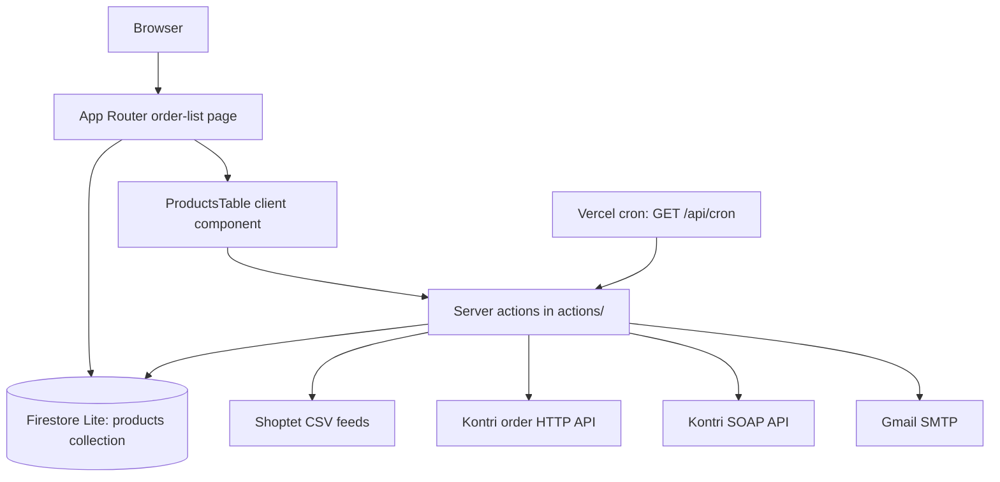

# Codebase Map

## 1. Overview

This is a single-application repository (not a monorepo) for processing Shoptet order products into Kontri orders and displaying their processing status. It uses Next.js 14 App Router, React 18, TypeScript, Firebase Firestore Lite, Tailwind CSS, and DaisyUI. Server-rendered routes, client components, server actions, Firestore access, and integration clients live in one Next.js application; no separate service or package boundary is configured.

The current implementation has two ways to run operational work: a Vercel cron route and buttons in the order-list UI. Both call server-side action functions.

## 2. Repository Tree

```text
.
├── actions/                   # Server-side feed, order, status, and mail workflows
├── app/
│   ├── (with-navbar)/          # Main order list and its navbar layout
│   ├── api/cron/               # Scheduled workflow HTTP endpoint
│   ├── globals.css             # Tailwind entry point
│   └── layout.tsx              # Root HTML layout, font, metadata
├── components/                 # Client-side table, modal, navbar, status control
├── db/                         # Firestore initialization and product queries/writes
├── docs/
│   └── CODEBASE_MAP.md          # This architecture map
├── public/                     # Static manifest and browser assets
├── types/
│   └── api/                    # External API response types
├── utils/                      # Mappers, date helpers, SOAP client, mail content
├── Dockerfile                  # Node 20 image; builds and starts Next.js
├── package.json                # npm scripts and dependencies
├── package-lock.json           # npm dependency lockfile
├── tsconfig.json               # Strict TypeScript config and @/* alias
└── vercel.json                 # Cron schedule for /api/cron
```

`node_modules/` and `.next/` are local dependencies/build output, not maintained source. `next-env.d.ts` is Next.js-managed. There are no package workspaces, test directories, or checked-in CI workflow files in the inspected repository.

## 3. Architecture Diagram



The diagram shows code-level calls and configured integrations. Feed URLs and the order HTTP API target are environment-configured; the SOAP WSDL and Firebase project identifiers are in source. The cron route authenticates its request before invoking actions.

## 4. Entry Points and Execution Flows

### Web application

- `app/layout.tsx` provides the root HTML layout, global styles, Inter font, and metadata.
- `app/(with-navbar)/layout.tsx` wraps the main route in `components/NavBar.tsx`.
- `app/(with-navbar)/page.tsx` is force-dynamic, loads the first 100 product documents through `db/getProducts.ts`, and renders `components/ProductsTable.tsx`.
- `components/ProductsTable.tsx` is a client component. It paginates by the last row's date, refreshes the first page, and invokes server actions for feed download, order submission, and Kontri status queries.

### Scheduled processing

`vercel.json` schedules `GET /api/cron` every ten minutes. `app/api/cron/route.ts` compares the request's `Authorization` header with `Bearer ${CRON_SECRET}`. An authorized request sequentially runs:

1. `actions/feedsDownload.ts` finds the latest stored product date, requests both Shoptet CSV feeds with that update time, and skips rows when a present item type is not `product`, a present item code does not start with `AK`, or a present supplier is not `Kontri.pl`; accepted rows are passed to `db/addProduct.ts`.
2. `actions/triggerOrdersSend.ts` resends products currently marked unconfirmed, then builds and sends at most one new order from products whose `AltumOrderID` is null.
3. `actions/updateOrdersState.ts` checks recent ordered groups and aggregated groups using `actions/checkOrderRefNumber.ts`, then updates Firestore status fields.

The route returns a JSON success message if all awaited calls complete, otherwise it logs the exception and returns `Response.error()`. The individual feed/send workflows also catch some errors internally and return status objects; the cron route does not branch on those returned status values.

### Order submission

- `db/getNewOrder.ts` queries the `products` collection for `AltumOrderID == null`, assigns one UUID-derived 16-character `RefNumber` to all selected products, persists that reference to each product, then calls `utils/createKontriOrder.ts`.
- `utils/createKontriOrder.ts` produces the Kontri request shape and derives numeric article IDs from the third hyphen-separated segment of `orderItemCode`.
- `actions/sendOrder.ts` POSTs the request to `GCP_SERVER_ADDRESS` as JSON.
- `actions/triggerOrdersSend.ts` interprets response codes and writes order/status/shortage fields with `db/updateProduct.ts`. Some unexpected outcomes generate email via `utils/sendOrderInfoMail.ts` and `actions/sendMail.ts`.
- `db/getUnconfirmedOrders.ts` selects status code `90`, groups products by `AltumOrderID`, and rebuilds a Kontri order for retry.

### Status checks

`utils/soapClient.ts` creates a SOAP client against the Kontri WSDL using `KONTRI_API_USER` and `KONTRI_API_PASSWORD`. `actions/checkOrder.ts` queries by Altum order ID; `actions/checkOrderRefNumber.ts` queries by reference number; `actions/checkServiceStatus.ts` calls the service health operation. The UI opens `components/OrderInfoModal.tsx` for successful order responses.

The status updater groups products by `RefNumber`. It considers status `100` orders from the preceding three days and status `300` groups for the aggregated-state pass. Its status mapping is in `actions/updateOrdersState.ts`.

## 5. Module and Dependency Map

| Area                | Main files                                                                                                                                                    | Responsibility and dependencies                                                                                                               |
| ------------------- | ------------------------------------------------------------------------------------------------------------------------------------------------------------- | --------------------------------------------------------------------------------------------------------------------------------------------- |
| Routing/rendering   | `app/layout.tsx`, `app/(with-navbar)/page.tsx`                                                                                                                | Next.js layout and order-list server render; page reads Firestore via `db/getProducts.ts`.                                                    |
| Browser UI          | `components/ProductsTable.tsx`, `components/OrderInfoModal.tsx`, `components/NavBar.tsx`, `components/CheckServiceStatusButton.tsx`                           | Table, pagination, manual controls, status modal, and service health control. UI invokes server actions and selected database reads directly. |
| Workflow actions    | `actions/feedsDownload.ts`, `actions/triggerOrdersSend.ts`, `actions/updateOrdersState.ts`                                                                    | Orchestrate import, order retries/submission, and status refresh. The cron route and UI both use parts of these workflows.                    |
| Integration actions | `actions/sendOrder.ts`, `actions/checkOrder.ts`, `actions/checkOrderRefNumber.ts`, `actions/checkServiceStatus.ts`, `actions/sendMail.ts`                     | HTTP order creation, SOAP query wrappers, and SMTP delivery.                                                                                  |
| Persistence         | `db/init.ts`, `db/addProduct.ts`, `db/getProducts.ts`, `db/getNewOrder.ts`, `db/getUnconfirmedOrders.ts`, `db/getLatestDate.ts`, `db/updateProduct.ts`        | Initialize Firebase and query/update the `products` collection.                                                                               |
| Domain/API types    | `types/ShopOrder.ts`, `types/KontriOrder.ts`, `types/api/*`                                                                                                   | Product, outgoing order, and external response shapes.                                                                                        |
| Shared utilities    | `utils/createKontriOrder.ts`, `utils/formatDate.ts`, `utils/findProductByAltum.ts`, `utils/soapClient.ts`, `utils/sendOrderInfoMail.ts`, `utils/constants.ts` | Order mapping, date formatting, SOAP client, notification content, and table page size.                                                       |

There is no separate service/repository framework or dependency-injection container evident in source. Server-action modules orchestrate several direct Firestore helper calls and integrations.

## 6. Data and Integration Map

### Stored data

Firestore is initialized in `db/init.ts` using the Firebase web SDK's Firestore Lite client. The configured project ID is `leontyna-kontri`; `FIREBASE_API_KEY` is read from the environment. The primary collection is `products`.

`types/ShopOrder.ts` describes the Shoptet product/order row plus processing fields including `AltumOrderID`, `RefNumber`, `kontriStatusCode`, `kontriStatusName`, `kontriOrderCode`, and `shortage`. `db/addProduct.ts` creates document IDs as `<code>_<orderItemCode>`, initializes new rows with status `0`, and skips an existing document. `db/updateProduct.ts` uses the same ID convention.

Statuses written or interpreted in source include:

| Code                | Source behavior                                                                                                 |
| ------------------- | --------------------------------------------------------------------------------------------------------------- |
| `0`                 | Imported item; not yet submitted (`db/addProduct.ts`).                                                          |
| `80`                | Kontri response marks products unavailable (`actions/triggerOrdersSend.ts`).                                    |
| `90`                | Unconfirmed response; later selected for resend (`actions/triggerOrdersSend.ts`, `db/getUnconfirmedOrders.ts`). |
| `100`               | Submitted/ordered response; includes Kontri order fields and shortage quantity when present.                    |
| `300`, `301`, `400` | Set by the status updater after SOAP status checks; specific mapping is in `actions/updateOrdersState.ts`.      |

The enum values for the external order status are in `types/api/CheckOrderResponse.ts`. Firestore security rules, indexes, retention, and operational backup configuration are not present in this repository.

### External integrations and configuration

| Integration                  | Code/configuration                     | Configuration keys or endpoint                                                                                    |
| ---------------------------- | -------------------------------------- | ----------------------------------------------------------------------------------------------------------------- |
| Shoptet CSV feeds            | `actions/feedsDownload.ts`             | `SHOPTET_URL`, `SHOPTET_URL_SK`; URLs are requested as CSV streams.                                               |
| Kontri order submission      | `actions/sendOrder.ts`                 | `GCP_SERVER_ADDRESS`; JSON POST endpoint.                                                                         |
| Kontri order/service queries | `utils/soapClient.ts`                  | Fixed WSDL `https://api.kontri.pl:8866/KontriAPIservice.svc?wsdl`; `KONTRI_API_USER`, `KONTRI_API_PASSWORD`.      |
| Firebase Firestore           | `db/init.ts`                           | `FIREBASE_API_KEY`; Firebase project config also contains source-defined project metadata.                        |
| Email                        | `actions/sendMail.ts`                  | Gmail SMTP transport; `SMTP_SERVER_USERNAME`, `SMTP_SERVER_PASSWORD`, and `SITE_MAIL_RECIEVER` (source spelling). |
| Scheduled invocation         | `app/api/cron/route.ts`, `vercel.json` | `CRON_SECRET`; configured every ten minutes at `/api/cron`.                                                       |

Environment variable names above are taken from source; this document intentionally contains no values. The worktree currently reports `.env.example` as deleted, so it was not used as an environment reference.

## 7. Testing and Build Map

- Runtime/dependency manager: npm, indicated by `package-lock.json` and npm scripts in `package.json`.
- Framework/build: Next.js 14; `npm run dev`, `npm run build`, and `npm run start` delegate to Next.js.
- Lint: `npm run lint` runs `next lint`. The inspected run completed with one warning: `components/ProductsTable.tsx` has a `useEffect` missing the `shopOrders` dependency.
- Type checking: `tsconfig.json` enables strict mode; there is no package script. `./node_modules/.bin/tsc --noEmit` completed successfully in this environment.
- Automated tests: no test script, test framework configuration, or test/spec files were found.
- CI: no checked-in `.github` workflow or other YAML workflow file was found.
- Deployment: `vercel.json` configures the cron job. `Dockerfile` uses `node:20-alpine`, runs `npm install`, builds with `npm run build`, then starts with `npm run start`.

The lint and type-check commands above were executed while preparing this map. A production build was not run. Runtime/build use requires the environment configuration listed above; the build may also depend on Next.js font fetching because `app/layout.tsx` configures `next/font/google` Inter.

## 8. Feature-to-File Index

| Task / feature                  | Start here                                | Related files                                                                                                                                 | Relevant tests |
| ------------------------------- | ----------------------------------------- | --------------------------------------------------------------------------------------------------------------------------------------------- | -------------- |
| Display and paginate products   | `app/(with-navbar)/page.tsx`              | `components/ProductsTable.tsx`, `db/getProducts.ts`, `utils/constants.ts`                                                                     | None found.    |
| Import Shoptet feed rows        | `actions/feedsDownload.ts`                | `db/getLatestDate.ts`, `db/addProduct.ts`, `utils/formatDate.ts`, `app/api/cron/route.ts`                                                     | None found.    |
| Create or resend Kontri orders  | `actions/triggerOrdersSend.ts`            | `db/getNewOrder.ts`, `db/getUnconfirmedOrders.ts`, `actions/sendOrder.ts`, `db/updateProduct.ts`, `utils/createKontriOrder.ts`                | None found.    |
| Check order state               | `actions/checkOrder.ts`                   | `actions/checkOrderRefNumber.ts`, `actions/updateOrdersState.ts`, `utils/soapClient.ts`, `db/getProducts.ts`, `components/OrderInfoModal.tsx` | None found.    |
| Check Kontri availability       | `components/CheckServiceStatusButton.tsx` | `actions/checkServiceStatus.ts`, `utils/soapClient.ts`, `components/NavBar.tsx`                                                               | None found.    |
| Send operational/error email    | `actions/sendMail.ts`                     | `utils/sendOrderInfoMail.ts`, `actions/triggerOrdersSend.ts`                                                                                  | None found.    |
| Change persisted product fields | `db/updateProduct.ts`                     | `types/ShopOrder.ts`, `actions/triggerOrdersSend.ts`, `actions/updateOrdersState.ts`                                                          | None found.    |
| Change scheduled processing     | `app/api/cron/route.ts`                   | `vercel.json`, `actions/feedsDownload.ts`, `actions/triggerOrdersSend.ts`, `actions/updateOrdersState.ts`                                     | None found.    |

## 9. Architectural Observations

### Confirmed

- The UI and scheduled route reuse server-action modules, but the UI can invoke the feed and order-send actions independently of the cron endpoint's Bearer-token check.
- Feed import, order submission, and status synchronization are orchestration workflows in `actions/`; persistence details are split into `db/` helpers, while SOAP and order conversion live in `utils/`.
- Product status transitions and Firestore writes are coordinated in workflow modules rather than through a centralized domain service.
- `actions/sendMail.ts` logs `SMTP_SERVER_USERNAME` and `SMTP_SERVER_PASSWORD` when transporter verification fails. This can expose credentials in application logs and is a security-sensitive existing behavior.
- `utils/sendOrderInfoMail.ts` interpolates product fields and serialized response/error data into HTML email content. The fields originate in feed/API data; encoding behavior is not implemented there.

### Unknowns / not inferred

- Firestore authorization rules and whether client-side Firebase access is restricted to this server environment are not included.
- The intended concurrency/locking guarantee for simultaneous cron and manual order submission is not documented. `getNewOrder.ts` reads unassigned products and then updates their reference numbers in separate operations.
- Shoptet feed contract, Kontri API semantics, production environment values, and the intended behavior for failed/partial cron steps require information outside this repository.
- There is no source evidence for deployment access controls beyond the cron Bearer check or for SMTP/Gmail account policy.

The observations above describe code and configuration, not a proposed redesign. Security-sensitive findings should be addressed through the owning operational change, not hidden by documentation.

## 10. Open Questions and Limitations

- No tests or CI configuration are present, so regression coverage and automated release gates could not be identified.
- No `.env.example` was available in the worktree (it is currently deleted); environment variable names were enumerated from source only.
- Firestore rules, indexes, schema validation, deployment project settings, and secrets management are external to this repository.
- The README is still the default create-next-app guide and does not explain this application's integrations or operational setup.
- The local lint run has the `ProductsTable` hook dependency warning described above. The production build was not executed; external font availability and complete deployment environment were not validated.
